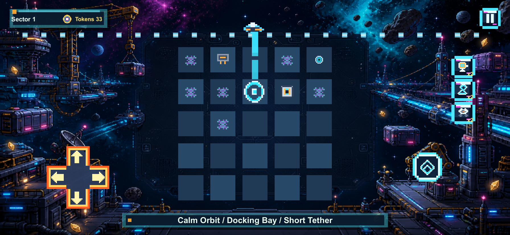
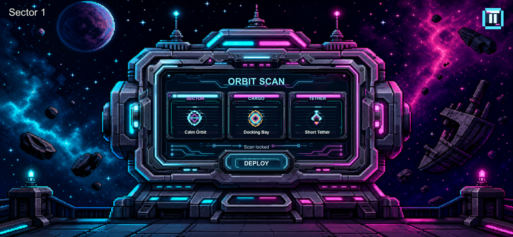

# Starhook Recovery

一款围绕钩索、货物与目标位置展开的网格休闲解谜游戏。玩家在障碍和不同规则组合下完成货物回收，项目通过网格状态与带种子的关卡生成组织玩法变化，适合展示数据建模、逻辑与显示分离及生成失败处理。

**项目角色：独立开发，负责全部开发工作。项目状态：已过审（开发者提供）。**

<!-- SCREENSHOT-GALLERY-START -->
## 游戏画面

以下为开发者提供的游戏画面，保留原始像素尺寸，仅作 PNG 无损压缩。点击图片可查看大图。

### 钩索与回收棋盘

横屏展示钩索、货物、网格和方向操作区。

### 轨道扫描界面

展示 Orbit Scan 界面及关卡开始前的规则信息。

<!-- SCREENSHOT-GALLERY-END -->

## 个人贡献

- 负责玩法设计、Unity/C# 实现、关卡规则配置、UI 与反馈表现、素材整合和调试交付，围绕钩索与货物移动组织解谜流程。
- 建立网格坐标、墙体、目标和箱体的数据结构，将占用与完成条件放在独立状态类中，减少玩法规则对场景对象的直接依赖。
- 实现带种子的无尽关卡生成，根据规则组合调整布局参数；加入坐标、数量、重叠和可达深度等检查，并以有限重试与后备布局处理生成失败。
- 维护移动端发布配置与 iOS/Android 导出脚本，管理产品标识、图标和交付资料。导出工具的存在与实际平台构建结果分别说明。

| 本地快照信息 | 内容 |
| --- | --- |
| Product Name | Starhook Recovery |
| Unity | 6000.3.11f1 |
| 本地版本 | 1.0.1 |
| 主场景 | `Assets/Scenes/Main.unity` |
| 源码目录 | `Assets/Scripts/StarhookRecovery/` |

## 推荐阅读顺序

1. [StarhookRecoveryData.cs](code/StarhookRecoveryData.cs)：`GridPoint` 的值相等性与哈希、关卡数组、生成请求和规则枚举。
2. [GridState.cs](code/GridState.cs)：独立于 GameObject 的墙体、目标和箱体状态；检查边界、排除重复箱体、移动占用检测和完成条件。
3. [EndlessLevelGenerator.cs](code/EndlessLevelGenerator.cs)：建议按 `NormalizeSettings → DrawForecast → Generate → TryGenerate → ValidateGeneratedLevel → BuildSafeFallbackLevel` 阅读，再查看 `TryReverseMoveBox` 和 `GenerationModifiers`。

三份文件均为完整原文件，保留原命名与代码，没有为了作品集重写生成算法。

## 可以讲清楚的实现

- `GridState` 用 `HashSet<GridPoint>` 存墙体和目标，用列表存箱体。箱体索引查询是线性查找；当前小棋盘中可读性优先，不能声称所有占用查询都是 O(1)。
- 相同设置、关卡编号和 salt 经种子公式生成相同随机序列，方便复现问题；这不是不同运行时版本之间的序列兼容保证。
- 先放目标，再将箱体从目标位置挪开构造初始布局，随后验证数组、坐标、重叠、锚点深度及规则所需元素。
- 生成有重试上限；失败后先尝试放宽生成，再构造固定后备布局，控制生成流程的工作量。
- 原参数把棋盘高度限制为 5，宽度限制为 5 到 8，箱体上限为 3。说明中按实际参数展示，不扩写成任意规模棋盘。

## 算法边界

`TryReverseMoveBox` 检查箱体相邻位置是否越界、被墙或其他箱体占用；没有模拟完整玩家/钩索移动及站位。`ValidateGeneratedLevel` 也没有运行求解器，因此这份代码不能证明每个生成关卡都能按实际规则通关。

固定后备布局会直接返回，未再次经过完整生成验证和难度底线检查。当前样例展示的是约束生成与后备策略，不是已证明的全局可解性算法。

## 依赖和验证

这组三份代码依赖 UnityEngine；组合后覆盖所选模块的直接类型依赖，但不包含主控制器、场景和资源。本次未导入 Unity，也未批量生成或求解关卡；验证仅包括源码一致性和文档链接。

下一步可以加入跨种子的规则测试、针对后备路径的测试，以及与实际移动规则一致的求解验证。它们是改进建议，未作为现有成果宣称。

[返回作品集](../../README.md)
