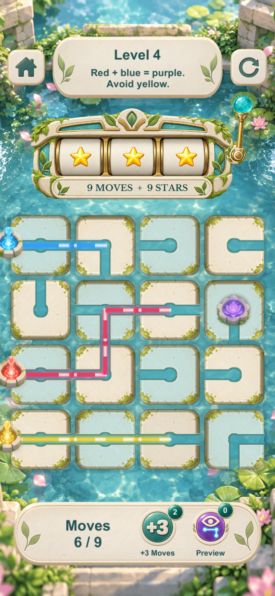
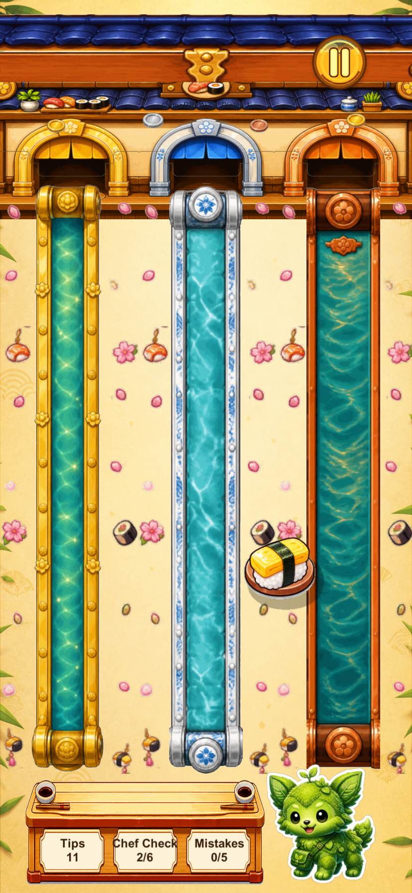
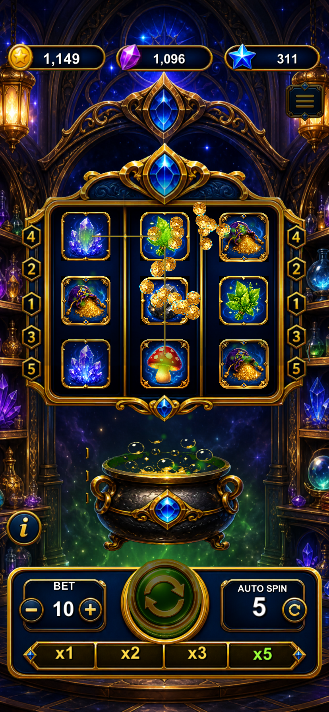

# Unity 休闲手游作品集

独立开发的五款 Unity/C# 休闲手游，负责玩法设计、程序实现、关卡与数值配置、UI 与反馈表现、素材整合及调试交付。开发过程中使用 Codex 辅助实现和迭代，独立承担项目设计、集成与交付责任。

作品集包含项目介绍、个人贡献、技术案例、12 张游戏截图与 19 份精选代码。建议先从特色玩法案例 Enchanted Wetlands 开始，再阅读其余项目；投递用的精简文案见[项目经历汇总](docs/PROJECT_EXPERIENCE.md)。

| 游戏 | 项目状态 | 推荐先读 | 展示内容 |
| --- | --- | --- | --- |
| [Enchanted Wetlands](projects/Enchanted-Wetlands/README.md) | 未上线，约一周开发 | [光路与颜色模拟](projects/Enchanted-Wetlands/code/LightPuzzleModel.cs) | 多源混色、滤色约束、干扰色排除、预览与渲染分离 |
| [Dream Repair](projects/Dream-Repair/README.md) | 已过审 | [手势采样与识别](projects/Dream-Repair/code/GestureInput.excerpt.cs) | 输入降采样、闭合判断、轨迹命中、安全区布局 |
| [Starhook Recovery](projects/Starhook-Recovery/README.md) | 已过审 | [网格状态](projects/Starhook-Recovery/code/GridState.cs) | 状态与显示分离、确定性生成、重试与后备关卡 |
| [Sushi Sprint Sorter](projects/Sushi-Sprint-Sorter/README.md) | 已过审 | [交互与选中](projects/Sushi-Sprint-Sorter/code/DragInput.excerpt.cs) | 拖拽状态、触摸容错、轨道吸附、存档与测试 |
| [Luck Cauldron](projects/Luck-Cauldron/README.md) | 已过审 | [规则计算](projects/Luck-Cauldron/code/AlchemyRules.cs) | 权重采样、配方优先级、升级服务、协程动画 |

## 游戏画面速览

点击项目名称进入完整说明；点击截图查看原图。

| Enchanted Wetlands | Sushi Sprint Sorter | Luck Cauldron |
| --- | --- | --- |
| <a href="projects/Enchanted-Wetlands/README.md"></a> | <a href="projects/Sushi-Sprint-Sorter/README.md"></a> | <a href="projects/Luck-Cauldron/README.md"></a> |

### Starhook Recovery

<a href="projects/Starhook-Recovery/README.md"></a>

[查看截图对应关系与待补内容](docs/SCREENSHOT_INDEX.md)。静态截图展示界面与当前画面，不代替交互、动画或性能验证。

## 阅读方式

- `original-file`：完整原文件，逐字节保留。完整文件仍可能依赖原项目的其他脚本和资源。
- `class-extraction`：从较长文件中抽取完整类，只增加引用、命名空间和来源注释，类体保持原样。
- `*.excerpt.cs`：类内部方法的阅读节选，保留原方法及数值，文件头列出依赖；不是可以单独编译的 Unity 脚本。
- `tests/`：原工程已有测试的节选，展示断言与测试思路；本次整理未运行这些测试。

共 19 份 C# 样例：9 份完整文件、2 份完整类抽取、8 份上下文节选。本仓库是源码作品集，不是完整 Unity 工程；没有提供场景、美术、完整控制器或可直接运行的游戏。

Enchanted Wetlands 为独立开发项目，开发周期约一周，目前尚未上线。其[玩法拆解](projects/Enchanted-Wetlands/MECHANICS.md)将“旋转水道、汇合所需颜色、排除第三种颜色”的玩家决策与对应源码关联；[简历项目描述](projects/Enchanted-Wetlands/RESUME.md)可用于投递和面试准备。

项目角色及状态由开发者提供，前四款按聊天中的“过包”记录标注为已过审；实际商店链接尚待补充。Enchanted Wetlands 的开发周期约一周，其余四款没有填写未经确认的周期。

代码来自本机工程快照。每款游戏的项目名、Unity 版本和本地版本号见各自说明；本地版本号不代表商店版本。各项目的演示视频及适用的商店链接可继续补充。聊天记录、源码与历史结果的使用范围见[资料依据](docs/PROJECT_FACTS.md)。

## 源码溯源与校验

[source-manifest.json](source-manifest.json) 记录原始源码相对路径、行号范围、源文件 SHA-256 和样例 SHA-256；[selection-plan.json](selection-plan.json) 记录提取规则。公开文件中不记录本机绝对路径。

在此目录运行：

```bash
node tools/curate.mjs verify
```

这会检查样例完整性和 Markdown 本地链接。如有对应五个原始工程，还可以指定 `selection-plan.json` 中来源目录的共同父目录，核对提取内容：

```bash
node tools/curate.mjs verify /path/to/source-parent
```

来源目录约定为父目录下的 `brr/com.*` 和 `game/EnchantedWetlands`，具体名称见提取清单。以上校验不包含 Unity 编译、运行、性能或真机验证。

## 求职阅读入口

[面试讲解提纲](docs/INTERVIEW_GUIDE.md) 给出每个模块的实现流程、可以追问的问题及当前代码的实际边界。[上传说明](docs/GITHUB_UPLOAD.md) 说明如何将本目录作为 GitHub 仓库发布。

[作品集截图清单](docs/SCREENSHOT_CHECKLIST.md) 保留拍摄要求并记录当前完成情况；[截图索引](docs/SCREENSHOT_INDEX.md) 列出本次整理的 12 张画面、来源文件名及待补材料。
